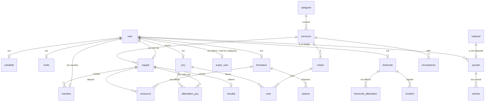

# Base de données GENIE UPB : guide pour l'équipe

Ce dossier contient les scripts SQL de la base Supabase. **Rien ne s'exécute tout seul** : chaque script se lance à la main dans Supabase > SQL Editor.

## Ordre de lancement (édition 2026)

| # | Fichier | Effet | Destructif ? |
|---|---|---|---|
| 1 | `archive_2025/01_archiver_2025.sql` | Copie toutes les données 2025 dans le schéma `archive_2025` (lecture seule, fermé à l'API publique) | Non |
| 2 | `archive_2025/02_vider_tables_edition.sql` | Vide `equipe`, `membre`, `invite`, `presence` | **Oui** (se termine par `rollback` tant qu'on ne le change pas en `commit`) |
| 3a | `invites/schema_invites.sql` | **Invités seulement** : marque, fiche, badge QR, scans, codes de vérification | Non |
| 3b | `schema/schema_complet_2026.sql` | Schéma complet (équipes, jury, matériel, etc.), à lancer après 3a ou à la place | Non (suppression des colonnes héritées désactivée) |
| 3c | `schema/adapter_triggers_existants.sql` | Adapte les déclencheurs déjà présents (`trg_accept_members`, e-mails) au schéma complet | Non (remplace le code d'une fonction, ajoute un déclencheur) |
| retour | `schema/annuler_schema_complet.sql` | Annule le 3b et revient au 3a (se termine par `rollback` tant qu'on ne le change pas en `commit`) | Oui, mais refuse si des données existent |

| 4 | `personnel/proposition_roles_et_benevoles.sql` | Rôles du personnel, demandes de bénévoles, traçabilité des badges. **Proposition, à valider avant de lancer** (voir `docs/badges-attribution.md`) | Non |
| 5 | `personnel/desactiver_service_python.sql` | **Plus nécessaire** (l'envoi aux participants n'est plus géré ici) : désactive les déclencheurs `envoi_mail` et `envoi_mail1` du service Python. A ne lancer que si quelqu'un d'autre les remplace ; sinon, les réactiver. Réversible | Non |

Si le schéma complet est déjà lancé et qu'on veut revenir aux invités seulement : lancer `annuler_schema_complet.sql`, puis `invites/schema_invites.sql`.

En cas de problème sur les invités : `schema/annuler_invites.sql` remet la table `invite` dans son état d'avant (données 2025 restaurées depuis l'archive) sans toucher aux autres tables. Il se termine par `rollback` tant qu'on ne le change pas en `commit`.

Avant le 2 : vérifier les chiffres de `archive_2025.archive_info`, exporter les tables en CSV (Supabase > Table Editor > Export), et avoir l'accord de toute l'équipe.
Le script 3 se lance une seule fois, après le 2.

## Schéma en un coup d'œil

## Toutes les tables

| Table | Rôle | Statut |
|---|---|---|
| `user` | Identité de tout le monde (nom, prénom, e-mail, numéro, filière, niveau, **matricule**, **genre**, **photo_url**, marque **invite**) | Existante, enrichie |
| `candidat` | Participant d'une équipe (acceptation du règlement et de la charte) | Nouvelle |
| `super_user` | Admins et chefs de catégorie (colonne `role`) | Existante, + `id_user` |
| `formateur`, `benevole`, `jury` | Un type de personne chacun, liés à `user` | Nouvelles |
| `invite` | Fiche invité : type (`etudiant_upb`, `particulier`, `entreprise`), entreprise, représentant, jours prévus, consentement | Existante, étendue |
| `categorie` | Catégories, avec taille min/max d'équipe et quota | Existante, enrichie |
| `concours` | Concours, avec horaire, salle, thème | Existante, enrichie |
| `equipe` | Équipe : chef, encadreur, statut d'inscription (brouillon, soumise, validée, refusée, liste d'attente) | Existante, enrichie |
| `membre` | Lien compte/équipe : rôle, invitation en attente/acceptée/refusée, invité sans compte par matricule | Existante, remaniée |
| `equipe_effectif` | Vue : nombre de membres acceptés par équipe | Nouvelle |
| `calendrier`, `recompense` | Planning et prix | Nouvelles |
| `seance`, `ressource` | Formations et fichiers (supports des formateurs, livrables des équipes) | Nouvelles |
| `critere`, `affectation_jury`, `note`, `resultat` | Évaluation | Nouvelles |
| `benevole_affectation`, `incident`, `materiel` | Terrain | Nouvelles |
| `qrcode` | Le badge (personne) ou l'étiquette (matériel) : jeton opaque, actif ou désactivé, un seul actif à la fois | Nouvelle |
| `activite` | Chaque scan : entrée, sortie, repas, matériel, présence à une séance | Nouvelle |
| `verification_code` | Code envoyé par e-mail (haché, expire en 10 min, 5 essais) | Nouvelle |
| `actualite` | Actualités du site | Inchangée |
| `presence` | Ancien journal des scans de 2025 | Inchangée, remplacée par `activite` |

## Type des identifiants

Toutes les clés primaires et tous les liens sont des `int` (jamais `bigint`). Le script 3 convertit aussi les colonnes existantes qui étaient en `bigint` (`user.id`, `categorie.id`, `equipe.id`, `membre.id` et `membre.id_equipe`, `super_user.id` et `id_categorie`, `concours.id_categorie` et `id_createur`, `presence.id_membre`).

## Colonnes héritées de 2025 : conservées pour l'instant

La section 10 du script 3, qui supprimait les anciennes colonnes, est **désactivée** (en commentaire). La base contient des déclencheurs écrits à la main, par exemple `trg_accept_members` sur `equipe`, qui dépendent de la colonne `equipe.statut`. Tant que l'équipe ne les a pas examinés, on ne supprime rien.

Les colonnes concernées (inutilisées par la nouvelle conception, mais laissées en place) :
- `membre` : `nom_prenom`, `nom_equipe`, `genre`, `niveau`, `filiere`, `statut`, `presence`, `last_scan_date`, `ticket_envoyer`. Les infos d'identité sont dans `user`.
- `equipe` : `membres` (jsonb), `nom_capitaine`, `statut` (booléen). On utilise `membre`, `id_chef` et `statut_inscription`.
- `invite` : `presence`, `last_scan_date`, `ticket_envoyer`. Le suivi passe par `activite`.

Pour décider quoi supprimer, lancer les deux requêtes en commentaire dans la section 10 du script : elles listent tous les déclencheurs et le code de toutes les fonctions.

## Règles métier prévues dans le schéma

- Un matricule et un e-mail ne peuvent appartenir qu'à une seule personne.
- Un compte est chef d'une seule équipe.
- Un compte est dans **une** équipe, ou dans **deux au maximum à condition que l'une des deux soit en Innovation**. C'est vérifié par la base (trigger sur `membre`). La catégorie Innovation est repérée par la colonne `categorie.permet_double_equipe` (le script la met à `true` pour le titre contenant « innovation » : à vérifier).
- Un membre peut ne pas avoir de compte : son invitation attend avec son matricule (et son e-mail).
- Un seul badge actif par personne et par matériel.
- Un juré ne note qu'une fois par critère et par équipe. La règle « pas d'équipe qu'il a encadrée » est dans l'API.
- Les résultats ne sont visibles qu'une fois `publie_le` renseigné.
- La journée de concours se remet à zéro à 5 h (`jour_concours`).

## Règles des invités

- Inscription ouverte après la clôture des équipes (18 décembre).
- Un compte déjà dans une équipe ne peut pas être invité. Un compte sans équipe peut l'être.
- `etudiant_upb` : matricule vérifié auprès de l'API des PCO, e-mail vérifié par code, création automatique d'un compte marqué invité.
- `particulier` et `entreprise` : pas de compte, pas de matricule, une inscription = une personne. Un étudiant d'une autre école est un particulier.
- Badge QR envoyé en pièce jointe d'un e-mail (Brevo). Il ne contient qu'un identifiant opaque.
- Droits d'un badge invité : entrée et sortie du site, pas de repas.
- Le poste de scan d'un bénévole a un contexte (entrée, sortie, repas...). Pas deux entrées de suite sans sortie.

## Points à valider par l'équipe

1. Le diagramme met niveau, filière, e-mail et photo dans `Candidat` et `Admin`. Dans le schéma, ils restent dans `user` (une seule source).
2. `Admin` et `ResponsableCatégorie` du diagramme sont tous deux `super_user` (colonne `role`). OK ?
3. La table `ressource` regroupe les fichiers envoyés par les formateurs et par les équipes. OK ?
4. Le tirage au sort et l'arbre des matchs du Droit ne sont pas modélisés (absents du diagramme).
5. Les partenaires (type de badge) n'ont pas de table propre.
6. Les types d'incident (`infirmerie`, `securite`, `logistique`, `organisation`) : le diagramme est coupé, à compléter.
7. Les noms de colonne `descripton_poject` (faute de frappe) et `motif_refus` de `equipe` sont conservés tels quels.
8. L'attribution du matériel aux équipes passe par `activite` (`materiel_demande`, `materiel_retour`) avec le badge du chef. Faut-il une table dédiée ?
9. `user.participant` et `user.role` (booléens) : les garder, ou les déduire des tables de type ?
10. RLS : activé sur les nouvelles tables seulement. À activer sur les anciennes quand l'API passera entièrement par la clé service role.
